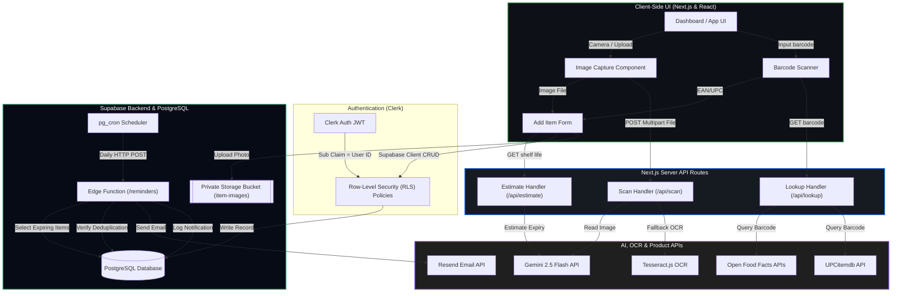

# Expire X — Technical Architecture & Workflow Documentation

Welcome to the comprehensive technical documentation for **Expire X**, a mobile-first, dark, glassmorphic expiry tracker built to manage the shelf life of food, medicines, cosmetics, documents, warranties, subscriptions, and other items. 

This document provides a highly detailed walkthrough of the technologies, workflows, APIs, databases, security mechanisms, camera integrations, and system flows that power Expire X.

---

## Table of Contents
1. [System Workflow & Architecture Overview](#1-system-workflow--architecture-overview)
2. [Flow Chart / Diagram of System Architecture](#2-flow-chart--diagram-of-system-architecture)
3. [Frontend Stack & UI/UX Design System](#3-frontend-stack--uiux-design-system)
4. [Backend Stack & Supabase Integration](#4-backend-stack--supabase-integration)
5. [Database Schema & Prisma Model Breakdown](#5-database-schema--prisma-model-breakdown)
6. [SQL Migration, Security Policies & Cron Jobs](#7-sql-migration-security-policies--cron-jobs)
7. [API Route Handlers (Mechanics & Code Flows)](#6-api-route-handlers-mechanics--code-flows)
8. [The Vision APIs & Key Management](#8-the-vision-apis--key-management)
9. [The Camera Property & Media Capture Hook](#9-the-camera-property--media-capture-hook)
10. [Daily Email Reminders Edge Function Code Flow](#10-daily-email-reminders-edge-function-code-flow)
11. [Service Worker & PWA Support](#11-service-worker--pwa-support)
12. [Application Screenshots](#12-application-screenshots)

---

## 1. System Workflow & Architecture Overview

Expire X operates on a client-server architecture where Next.js runs both the interactive client-side application and the server-side API Route Handlers. Data isolation and serverless database storage are provided by Supabase, while user authentication is managed natively by Clerk.

### Core User Journeys

#### A. Scanning & Adding an Item
1. **Initiation**: The user clicks "Add Item" on the dashboard or `/items/new` page.
2. **Capture**: The client invokes the camera using browser media devices (`navigator.mediaDevices.getUserMedia`) or accepts an image upload.
3. **API Processing**: The image is sent to `/api/scan` (Next.js server-side endpoint) where the backend selects an OCR engine:
   - **Primary Engine**: Gemini 2.5 Flash, which accepts the base64-encoded image and extracts structured metadata in a single step.
   - **Fallback Engine**: Tesseract.js reads the text from the image locally on the server. The raw text is then sent to Gemini to be structured, or parsed locally using regex if the AI fails.
4. **Enhancement**: If the barcode was scanned instead of a label photo:
   - The barcode is sent to `/api/lookup` which queries Open Food Facts, Open Beauty Facts, Open Products Facts, and UPCitemdb.
   - An expiry estimate is generated by `/api/estimate` (using Gemini or local rules) based on the category and manufacture date.
5. **Confirmation**: The extracted metadata (name, category, dates, quantity, unit, etc.) is loaded into the user-facing form.
6. **Save**: The user reviews the details and clicks **Save**. The client sends an insert query directly to Supabase. This query is checked against Supabase Row-Level Security (RLS) policies.

#### B. Daily Email Reminders (Cron Job)
1. **Trigger**: An automated scheduler (`pg_cron`) in Supabase triggers a daily job at `08:00 Asia/Kolkata` (`30 2 * * *` UTC).
2. **Request**: The job makes a HTTP POST request to the `/reminders` Supabase Edge Function, passing a shared secret (`CRON_SECRET`) for verification.
3. **Lookup**: The Edge Function queries the database to find items expiring in exactly 30, 15, 7, 3, or 1 days.
4. **Deduplication**: It filters out items that have already been notified for that specific reminder level by checking against the `notification_log` table.
5. **Dispatch**: For each eligible item, it calls the Resend API to send a customized reminder email to the owner.
6. **Log**: Upon successful email delivery, a record is added to the `notification_log` to prevent duplicate emails.

---

## 2. Flow Chart / Diagram of System Architecture

The following diagram maps the flow of data and control across the client, server routes, database tables, auth systems, AI processors, and reminder dispatchers:



---

## 3. Frontend Stack & UI/UX Design System

The Expire X frontend is optimized for quick, one-handed mobile interactions (mobile-first layout). It uses a clean, premium dark mode styling.

### UI/UX Styling Details
1. **Vibe & Aesthetic**: A glassmorphic design featuring dark slate background gradients, thin translucent borders (`border-white/10`), blur filters (`backdrop-blur-md`), and glowing accent buttons.
2. **Typography**: Uses the Google Fonts **Inter** font family for clean readability.
3. **Color Palette**: Custom tailwind configuration avoiding basic colors:
   - **Primary**: Deep Blue (`#2563EB`)
   - **Accent**: Soft Violet (`#8B5CF6`)
   - **Warning**: Amber/Orange for items expiring soon
   - **Danger**: Crimson Red for expired items
   - **Success**: Emerald Green for fresh items
4. **Micro-Animations**: Uses hover translation states, active button shrink scales, fade-in entry transitions, and loading spinners to keep the interface feeling responsive.

### Main Views
- **Landing Page**: Marketing hero section, list of features, visual interactive mockups, detailed FAQs, and CTAs.
- **Dashboard**: Quick-scan panel (barcode, camera, receipt, manual), high-level stats (Total, Expiring Soon, Expired, Added this Week), and a list of items expiring in the next 30 days.
- **Items Shelf**: Complete paginated inventory list supporting query searching, category tags, and status filtering.
- **Add/Edit Item Form**: Smart form that adapts to OCR data, displaying a side-by-side view of the estimated shelf life details and AI confidence tips.
- **Shopping List**: Dynamic list that auto-suggests items to repurchase based on what has expired or is expiring soon, with manual add and mark-as-bought actions.
- **Settings Drawer**: Slidout side panel for general configurations, dark/light theme switching, push notifications toggling, and account actions (Sign Out).

---

## 4. Backend Stack & Supabase Integration

The Expire X backend splits responsibility between Next.js server components and the Supabase Postgres ecosystem.

### Supabase Core Integration
1. **PostgreSQL Database**: Holds all tables, views, indices, and RLS rules.
2. **Row-Level Security (RLS)**: Enforces complete user isolation. Since Clerk is used for auth, Clerk session tokens are forwarded to the Supabase client. The JWT is validated by Supabase, and RLS checks the `auth.jwt() ->> 'sub'` sub claim against the `user_id` of the row.
3. **Supabase Storage**: Private storage bucket `item-images` stores product pictures. Access is controlled by bucket RLS policies, allowing reads and writes only if the owner's authenticated ID matches the directory path (`(role() = 'authenticated'::text) AND ((bucket_id = 'item-images'::text) AND (storage.foldername(name))[1] = (auth.jwt() ->> 'sub'::text))`).
4. **Supabase Edge Functions (`reminders`)**: A lightweight Deno service role client that runs independently, queries Postgres database, evaluates dates, and contacts Resend.

---

## 5. Database Schema & Prisma Model Breakdown

Prisma maps the PostgreSQL schemas and handles dev migrations. The DB tables are defined below:

### `users` Model
Stores registered Clerk users, enabling the reminder cron to query email addresses.
- **`id`** (`String`, Primary Key): The Clerk user ID (e.g. `user_2ab...`).
- **`email`** (`String`): The primary email address of the user.
- **`emailRemindersEnabled`** (`Boolean`, default: `true`): User preference for opt-in/opt-out daily notifications.
- **`createdAt`** (`DateTime`): Timestamp when the user profile was synchronized.

### `items` Model
Stores items tracked by the user.
- **`id`** (`UUID`, Primary Key): Database-generated unique ID.
- **`userId`** (`String`): Foreign key referencing `users.id`.
- **`name`** (`String`): The name of the item.
- **`category`** (`Category`): Enum value representing item category (`food`, `medicine`, `cosmetics`, `documents`, `warranty`, `subscription`, `other`).
- **`expiryDate`** (`DateTime`): The official date of expiration.
- **`manufactureDate`** (`DateTime?`, Optional): Manufacture date.
- **`quantity`** (`Decimal?`, Optional): Numerical size/amount.
- **`unit`** (`String?`, Optional): Units (e.g., `g`, `ml`, `pcs`).
- **`openedDate`** (`DateTime?`, Optional): Date when the user opened the product.
- **`openWithinDays`** (`Int?`, Optional): Safe window of use after opening (Period-After-Opening).
- **`effectiveExpiry`** (`DateTime?`): DB-computed field evaluating `least(expiry_date, opened_date + open_within_days)`.
- **`imageUrl`** (`String?`, Optional): Reference URL to the uploaded label image in Supabase storage.
- **`barcode`** (`String?`, Optional): The barcode scanned (EAN/UPC).
- **`location`** (`String?`, Optional): Storage location (e.g. `Fridge`, `Pantry`).
- **`notes`** (`String?`, Optional): User notes.
- **`createdAt`** & **`updatedAt`** (`DateTime`): Timestamps.

### `shopping_list` Model
- **`id`** (`UUID`, Primary Key): Database-generated unique ID.
- **`userId`** (`String`): Foreign key referencing `users.id`.
- **`name`** (`String`): Product name.
- **`quantity`** (`Decimal?`): Count needed.
- **`unit`** (`String?`): Unit.
- **`checked`** (`Boolean`, default: `false`): Checked status.
- **`source`** (`String`, default: `manual`): Indicates if added manually or auto-generated by approaching expiry.
- **`itemId`** (`UUID?`, Optional): Reference to the original item.

### `notification_log` Model
Used for deduplication to prevent sending duplicate emails.
- **`id`** (`UUID`, Primary Key): Database-generated unique ID.
- **`itemId`** (`UUID`): References `items.id`.
- **`userId`** (`String`): References `users.id`.
- **`reminderType`** (`ReminderType`): Enum value (`d30`, `d15`, `d7`, `d3`, `d1`).
- **`sentAt`** (`DateTime`): Timestamp when sent.
- **Unique Constraint**: `@@unique([itemId, reminderType])` ensures only one email is sent per item per level.

---

## 6. SQL Migration, Security Policies & Cron Jobs

### A. RLS Policies and Storage Trigger Setup (`0001_rls_and_storage.sql`)
The Row Level Security policies ensure that users cannot select, update, insert, or delete another user's files.
```sql
-- Enable RLS on database tables
alter table public.users            enable row level security;
alter table public.items            enable row level security;
alter table public.notification_log enable row level security;

-- Policies for public.users
create policy users_select_own on public.users for select to authenticated 
  using (id = (auth.jwt() ->> 'sub'));
create policy users_insert_self on public.users for insert to authenticated 
  with check (id = (auth.jwt() ->> 'sub'));
create policy users_update_own on public.users for update to authenticated 
  using (id = (auth.jwt() ->> 'sub')) with check (id = (auth.jwt() ->> 'sub'));

-- Policies for public.items
create policy items_select_own on public.items for select to authenticated 
  using (user_id = (auth.jwt() ->> 'sub'));
create policy items_insert_own on public.items for insert to authenticated 
  with check (user_id = (auth.jwt() ->> 'sub'));
create policy items_update_own on public.items for update to authenticated 
  using (user_id = (auth.jwt() ->> 'sub')) with check (user_id = (auth.jwt() ->> 'sub'));
create policy items_delete_own on public.items for delete to authenticated 
  using (user_id = (auth.jwt() ->> 'sub'));
```

For file storage, RLS prevents visual access to uploaded images of other users:
```sql
-- Enable RLS for file bucket item-images
create policy item_images_select_own on storage.objects for select to authenticated
  using (bucket_id = 'item-images' and (storage.foldername(name))[1] = (auth.jwt() ->> 'sub'));
create policy item_images_insert_own on storage.objects for insert to authenticated
  with check (bucket_id = 'item-images' and (storage.foldername(name))[1] = (auth.jwt() ->> 'sub'));
```

### B. Daily Scheduler Setup (`0002_cron.sql`)
The daily scheduler relies on `pg_cron` and `pg_net` to call the reminders edge function:
```sql
create extension if not exists pg_cron;
create extension if not exists pg_net;

select cron.schedule(
  'expirex-daily-reminders',
  '30 2 * * *', -- 02:30 UTC / 08:00 IST
  $$
  select net.http_post(
    url     := 'https://<PROJECT_REF>.functions.supabase.co/reminders',
    headers := jsonb_build_object(
      'Content-Type', 'application/json',
      'x-cron-secret', '<CRON_SECRET>'
    ),
    body    := '{}'::jsonb
  );
  $$
);
```

---

## 7. API Route Handlers (Mechanics & Code Flows)

Next.js Route Handlers in `app/api/` manage the backend logic for scanning, estimating, and searching products.

### A. Scan Endpoint (`/api/scan`)
- **Path**: [app/api/scan/route.ts](file:///Users/pratyushsinha/Downloads/ExpireX/app/api/scan/route.ts)
- **Engine Selection**: Reads the `?engine=ai|tesseract` URL search parameter.
- **Base64 Processing**: Receives image files via multipart forms, extracts binary buffers, and handles base64 conversions.
- **Gemini Extraction**: Passes the base64 image data to the `gemini-2.5-flash` model, requesting JSON structured output according to `extractionSchema`.
- **Tesseract Fallback**: If Gemini fails or the offline engine is requested, it starts a local Tesseract.js worker with Page Segmentation Mode (PSM) 6 (dense label mode). Once text is extracted:
  1. It attempts to structure the text using Gemini.
  2. If the AI is completely unreachable, it falls back to regex date extraction (`findDates()`) and matches common keywords like `EXP`, `MFG`, and `PKD` to identify dates.
- **Shelf-life Estimate Fallback**: If the scan yields a product name but no expiry date, the scanner calls the Gemini shelf-life estimator or uses a local fallback rule to suggest an expiry date, ensuring the user doesn't get an empty field.

### B. Barcode Lookup Endpoint (`/api/lookup`)
- **Path**: [app/api/lookup/route.ts](file:///Users/pratyushsinha/Downloads/ExpireX/app/api/lookup/route.ts)
- **Parallel Fetching**: Queries multiple open databases in parallel:
  - **Open Food Facts**: `world.openfoodfacts.org` (resolves food details)
  - **Open Beauty Facts**: `world.openbeautyfacts.org` (resolves cosmetics details)
  - **Open Products Facts**: `world.openproductsfacts.org` (resolves general items)
  - **UPCitemdb API**: `api.upcitemdb.com` (provides fallback search with wide commercial product coverage)
- **Deduplication & Refinement**: Aggregates the results, maps category tags to our enum, screens out unsupported categories (like electronics, appliances, and clothing), and returns structured data.

### C. Expiry Estimation Endpoint (`/api/estimate`)
- **Path**: [app/api/estimate/route.ts](file:///Users/pratyushsinha/Downloads/ExpireX/app/api/estimate/route.ts)
- **Concept**: If an item name and category are known, it estimates a realistic expiry date.
- **Gemini Knowledge**: Prompts Gemini with rules detailing average unopened shelf lives:
  - Fresh perishables: Days to ~2 weeks.
  - Packaged foods: Months to 2 years.
  - Medicines: 1 to 3 years from manufacture.
  - Cosmetics: 2 to 3 years unopened (accompanied by Period-After-Opening suggestions).
- **Output**: Returns the estimated expiry date, a confidence rating (`high`, `medium`, `low`), a clinical explanation of the basis, and storage safety tips.

---

## 8. The Vision APIs & Key Management

Expire X coordinates scanning by using key environment variables.

### Gemini API Key (`GEMINI_API_KEY`)
- **Provider**: Google AI Studio.
- **Model**: `gemini-2.5-flash` (multimodal).
- **Implementation**: Bypasses traditional Google Cloud Vision setups. Rather than sending the image to an OCR endpoint and then processing the text in a separate step, the base64-encoded image is sent directly to Gemini in a single API call. Gemini performs the OCR and extracts structured JSON based on our system prompt:
  ```ts
  const result = await model().generateContent([
    { text: prompt },
    { inlineData: { data: imageBase64, mimeType } },
  ]);
  ```
- **Benefit**: Faster, cheaper, and more accurate, as the AI understands the context of the layout (e.g. recognizing that a date next to the text "EXP" is the expiry date).

### Google Vision Credentials (`GOOGLE_VISION_CREDENTIALS_B64`)
- **Context**: Included in the setup instructions (`README.md`) as a legacy configuration or potential backup service.
- **Status**: Currently, the application uses Gemini 2.5 Flash as the primary OCR engine and Tesseract.js as the offline fallback, removing the need for a Google Cloud Vision API setup and GCP billing.

---

## 9. The Camera Property & Media Capture Hook

Expire X interacts with the device's physical camera through a client-side component.

### The Camera Hook Mechanics
- **Path**: [components/image-capture.tsx](file:///Users/pratyushsinha/Downloads/ExpireX/components/image-capture.tsx)
- **API**: Uses the browser's `navigator.mediaDevices.getUserMedia` API.
- **Constraints Configuration**:
  ```ts
  const stream = await navigator.mediaDevices.getUserMedia({
    video: { facingMode: { ideal: facingMode } },
    audio: false,
  });
  ```
- **Facing Mode**:
  - `environment`: Targets the back camera on mobile phones (optimal for reading product barcodes and labels).
  - `user`: Targets the front camera (fallback or selfies).
- **Rendering**: Connects the returned `MediaStream` to a hidden/styled HTML `<video>` element, playing it inline on the screen (`playsInline muted`).
- **Capture Process**:
  1. Once the user clicks "Capture", the app dynamically creates an off-screen HTML `<canvas>` element.
  2. Sets the canvas dimensions to match the raw video resolution (`video.videoWidth` & `video.videoHeight`).
  3. Draws the current frame from the video element to the canvas context: `ctx.drawImage(video, 0, 0)`.
  4. Calls `canvas.toBlob` with `image/jpeg` compression (quality factor `0.9`).
  5. Wraps the output blob in a `File` object (`new File([blob], "capture.jpg", { type: "image/jpeg" })`) and passes it to the parent component for API submission.
  6. Releases the camera hardware by stopping all active media tracks (`stream.getTracks().forEach(t => t.stop())`).

---

## 10. Daily Email Reminders Edge Function Code Flow

The reminder function runs in a secure, serverless container inside Supabase Edge Functions. It does the following:

1. **Secure Handshake**: Inspects incoming headers for the `x-cron-secret` and compares it against the stored `CRON_SECRET` variable.
2. **Date Range Mapping**: Evaluates the date in Asia/Kolkata timezone:
   - Sets the target offset dates: `+30`, `+15`, `+7`, `+3`, and `+1` days.
3. **Database Pull**: Selects all items whose `effective_expiry` matches one of the target offset dates:
   ```ts
   const { data: items } = await supabase
     .from("items")
     .select("id, name, expiry_date, effective_expiry, user_id, users(email, email_reminders_enabled)")
     .in("effective_expiry", dueDates);
   ```
4. **Idempotence Filtering**: Pre-fetches the `notification_log` table entries matching the pulled item IDs. If a match is found for that specific offset (e.g. `d7`), it skips processing.
5. **Resend Handshake**: Sends a structured HTML reminder email using the Resend SDK.
6. **Log Creation**: Once Resend confirms a successful delivery, it inserts a deduplication entry in `notification_log`.

---

## 11. Service Worker & PWA Support

To provide PWA (Progressive Web App) features:
1. **Manifest File** (`public/manifest.webmanifest`): Specifies app icon (`icon.svg`), theme color (`#070B16`), and display rules (`standalone` layout, which removes the browser frame).
2. **Service Worker** (`public/sw.js`): Handles offline caching of assets and listens to incoming push notification events.
3. **Registration Hook** (`components/pwa-register.tsx`): Installs the Service Worker at runtime:
   ```ts
   if ("serviceWorker" in navigator) {
     navigator.serviceWorker.register("/sw.js")
       .then(reg => console.log("Service Worker registered successfully"))
       .catch(err => console.error("Service worker registration failed", err));
   }
   ```

---

## 12. Application Screenshots

Here are screenshots showing the Expire X web application:

### A. Landing Page
This screen displays the user-facing landing page, detailing core features, visual cards representing tracked items, a neat step-by-step workflow guide, and pricing details.


### B. User Dashboard
The dashboard displays quick actions (Scan Barcode, Scan Photo, Scan Receipt, Add Manually), high-level counters, and a list of items expiring in the next 30 days.


### C. Items Shelf (Inventory)
Shows the complete list of items in the user's inventory with status labels, search boxes, and filters.


### D. Shopping List Page
Displays auto-suggested shopping list items based on expiring or expired items, along with manually added items.


### E. Add Item Manual Form
The form for adding items manually, including smart AI estimation options, period-after-opening parameters, and picture upload.


### F. Settings Drawer
The configuration panel for theme settings, push notifications toggle, FAQs, and accounts management.


---

*Documentation compiled by Antigravity, Google DeepMind team.*
